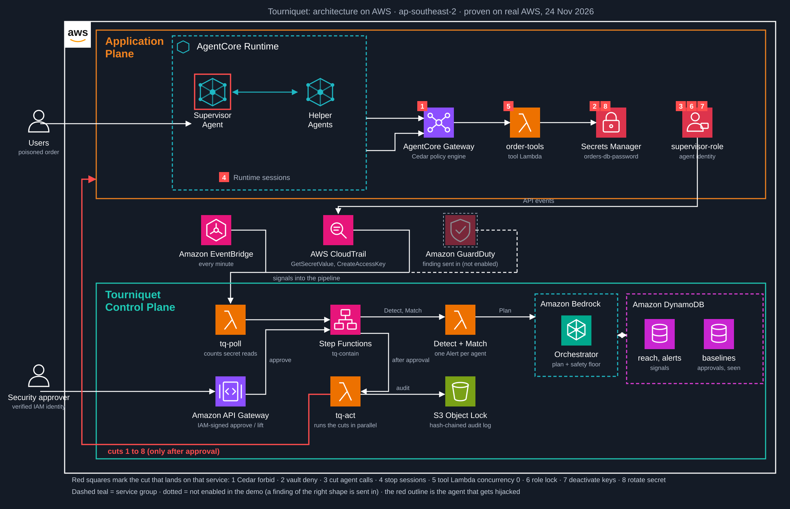
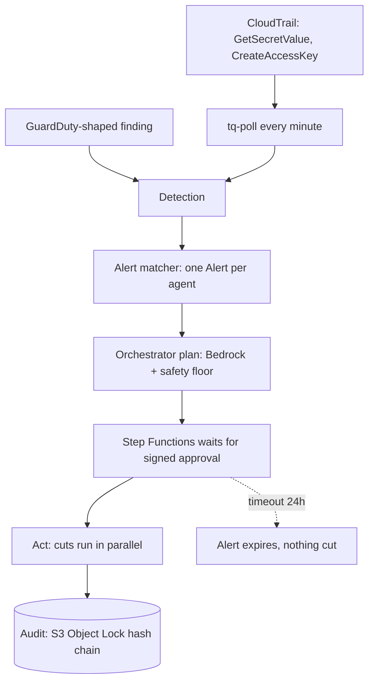

# Architecture

Tourniquet limits the damage when an AI agent on AWS Bedrock AgentCore is hijacked. It watches for signals, groups them into one Alert per agent, proposes a set of cuts, waits for a verified person to approve, then cuts the agent's reach in parallel while its helper agents keep running.

## Scope of this release

| | |
|---|---|
| Alert types supported | **Type 1** threat finding (GuardDuty finding shape) and **Type 3** secret misuse (an agent role reads secrets far above its own normal, counted from CloudTrail) |
| Also in the code | type 2 identity change (an agent role creates an access key). The scenario's hijacked role does this too, which gives cut 7 its key to deactivate. |
| Experimental, not covered by the proofs | type 4 tool or call shift, 5 gateway denies, 6 prompt injection, 7 manual |
| Containment | eight cuts, all proven on real AWS |



## Two planes

- **Application plane**: the sample shop. A supervisor agent behind an AgentCore Gateway, a tool Lambda, a vault secret in Secrets Manager, helper agents, an AgentCore Runtime.
- **Control plane**: Tourniquet itself. It only reads the application plane until a person approves a plan.

## Components

| Component | What it is | What it does |
|---|---|---|
| Collector | Lambda code (`collector.py`) | Builds the **reach map** per agent from the account: role, tool Lambda, secrets, Runtime, Gateway. Marks secrets that helpers also use as shared. Stored in `tq-reach`. |
| Poller `tq-poll` | Lambda, runs every minute | Reads CloudTrail `CreateAccessKey` and `GetSecretValue` events made by agent roles. A create-key starts the state machine with the real record. Secret reads are counted per role per minute (the minute the event happened) in `tq-baselines`; a pipeline starts only when a minute reaches the threshold. Each event is acted on once (`tq-seen`). |
| Detection | `core.detect` | Turns a record into a signal. Type 1: pass-through of a GuardDuty finding about an assumed role. Type 3: the poller's secret-read spike (at least 10 reads in a minute and at least 5 times the role's own normal, a slow average kept in `tq-baselines`; a spike minute is not learned as normal; Tourniquet's own `tq-` roles are ignored). Type 2: fixed rule, an agent role creating a key is always suspicious. |
| Alert matcher | `core.match` | Adds the signal to the agent's single open Alert. Evidence is deduplicated by `signal_id`; updates use a version check and conditional writes. |
| Severity | `core.py` | Sum of signal strengths plus blast radius. **High at 6 or more.** Type 1 = 1, type 3 = 3, type 2 = 3, blast radius (agents reachable) = 2, so a secret-read spike plus one finding is High. These weights are stand-ins. |
| Orchestrator | Bedrock Converse (`TQ_MODEL`) | Proposes which of the cuts to apply and why. A safety floor in code keeps every available step except 8; the model decides only step 8. On any model error it falls back to rules and records that in the plan. |
| Step Functions `tq-contain` | State machine | Detect, Match, Plan, wait for approval (task token, 24 h), Act. Retries with backoff on Detect, Match and Plan. On timeout the Alert expires and nothing is cut. |
| Approval API | API Gateway HTTP API, IAM auth | `POST /approve`, `POST /lift`, `GET /plans`. The approver is the verified caller ARN. Only roles on `TQ_APPROVERS` may approve; the agent's owner, the Orchestrator, a stranger and a typed name are refused. |
| Act | Lambda | Runs the cuts in parallel. One failed step does not stop the others. |
| Audit | S3 Object Lock bucket | Every state change is written as a hash-chained record. `verify_audit` checks the chain. |
| Tables | DynamoDB | `tq-reach`, `tq-alerts`, `tq-sessions`, `tq-signals`, `tq-approvals`, `tq-seen`, `tq-baselines` |

## Flow



The same flow as text:

```
CloudTrail secret-read spike (type 3) ┐
GuardDuty-shaped finding (type 1) ───┤
                                     ▼
              Detection → Alert matcher (one Alert per agent) → Orchestrator plan
                                     ▼
        Step Functions waits for a signed approval (API Gateway, IAM auth)
                                     ▼
              Act: cuts run in parallel → audit log (S3 Object Lock)
                                     ▼
              Signed lift undoes the reversible cuts
```

## The eight cuts

| # | Cut | Mechanism | Undone by lift |
|---|---|---|---|
| 1 | Cedar forbid | AgentCore Policy forbid on the Gateway for the caller role | yes |
| 2 | Vault deny | explicit Deny for the role in the secret's resource policy | yes |
| 3 | Cut agent calls | inline Deny on `lambda:Invoke*` and `bedrock-agentcore:InvokeAgentRuntime` | yes |
| 4 | Stop sessions | `StopRuntimeSession` for the agent's Runtime sessions | no, by design |
| 5 | Tool Lambda concurrency 0 | reserved concurrency | yes |
| 6 | Role lock | inline Deny `*` on the agent role (`TourniquetQuarantine`) | yes |
| 7 | Deactivate keys | `UpdateAccessKey` Inactive on keys the agent created | no, by design |
| 8 | Rotate secret | new value as AWSCURRENT, old removed from AWSPREVIOUS; only for secrets no helper uses | no, by design |

Chains run in parallel: `[1] [4] [3] [5] [6] [7] [2,8]` (8 after 2). Steps 1, 2 and 4 run only if the reach map says the agent has that engine, secret or Runtime.

## Design decisions

- **Humans approve every cut.** The pipeline detects and plans on its own; Act never starts without a signed approval from an allow-listed role that is not the agent's owner.
- **Idempotent everywhere.** Signals deduplicate by `signal_id`, events by CloudTrail `eventID`, plans are stored on the Alert, claims are conditional.
- **Helpers keep running.** Cuts target only the contained agent's role. A secret shared with helpers is never rotated.
- **Tamper-evident audit.** Hash chain in an Object Lock bucket.
- **Fail safe.** Approval timeout expires the Alert and cuts nothing. A failed Bedrock call falls back to rules.

## Limits

- Detection lags by about a minute (poll) plus CloudTrail delivery (1 to 2 minutes seen).
- Steps 4, 7 and 8 are not undone by a lift.
- Step 3 cuts agent-to-agent and Lambda invocation only, not other outbound calls.
- Step 8 changes the vault value only; changing the password inside the database is the application's job.
- API Gateway cuts a request off at 30 s; a lift takes about 7 s.
- See `docs/THREAT_MODEL.md` for what is and is not defended.
