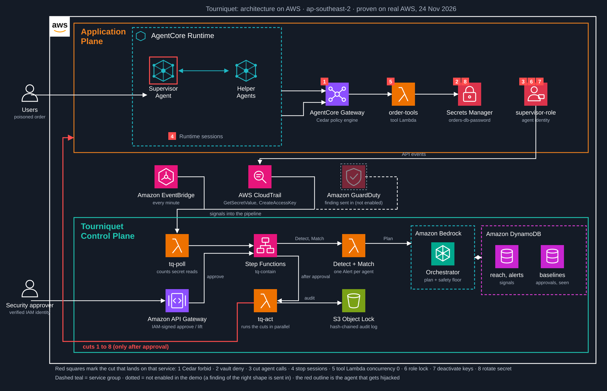

<div align="center">

# 🩹 Tourniquet

### Cut the hijacked agent, not the whole system.

Blast-radius containment for AI agents on **AWS Bedrock AgentCore**

    

[Architecture](ARCHITECTURE.md) · [Deployment](DEPLOYMENT.md) · [Runbook](docs/RUNBOOK.md) · [Threat model](docs/THREAT_MODEL.md) · [Proof results](results/RESULTS.md)

</div>

---

## The problem in one sentence

A hijacked agent is already holding valid credentials, so by the time a person notices, it has read the secrets, called other agents and minted new keys. **Shutting down everything stops the attack and the business.** A tourniquet stops the bleeding on one limb and keeps the patient alive.

## The concept

Tourniquet is built on four ideas.

**1. Contain, don't shut down.** A hijacked agent already holds valid credentials, so blocking its login does nothing. What limits the damage is shrinking what that one agent can *reach*: the secrets it can read, the tools it can call, the other agents it can invoke, the keys it can mint. Everything else keeps running. That is the tourniquet: stop the bleeding on one limb, keep the patient alive.

**2. Know the reach before the attack.** A Collector maps, for every agent, the role it runs as, the tool Lambda, the secrets it reads, the agents it calls and the Runtime sessions it holds. It also marks what is *shared* with helper agents, because cutting a shared secret would hurt innocent agents too. When an alert fires, the cuts are already worked out.

**3. One story per agent, then one decision.** Signals (a burst of secret reads, a threat finding, a new access key) each add evidence to a single Alert for that agent, so a flood of events becomes one plan, not a hundred. A Bedrock model proposes which of the eight cuts to apply and explains why. Code enforces a safety floor so the model can never cut too little, and a plain-rules fallback means a model failure never blocks containment.

**4. A human holds the switch, and everything is on the record.** Nothing is cut until a verified person approves with a signed IAM identity. The agent's owner and the Orchestrator itself are refused. The cuts then run in parallel, a signed lift reverses the reversible ones, and every step is appended to a tamper-evident audit chain.

```
   SEE            →   GROUP        →   PLAN           →   DECIDE        →   CUT              →   UNDO / PROVE
signals from          one Alert        Bedrock picks      a verified        8 cuts in            signed lift,
CloudTrail,           per agent        the cuts and       person approves   parallel; helpers    audit hash chain
GuardDuty-shaped                       says why           (signed IAM)      keep running
```

Two planes keep this honest: the **application plane** (the agents and what they use) is only read until a person approves; the **control plane** (Tourniquet) is the only thing that can change it.

## What Tourniquet does

```
   something looks wrong            one story per agent           a person decides            only that agent is cut
┌───────────────────────────┐   ┌───────────────────────┐   ┌──────────────────────┐   ┌───────────────────────────┐
│  30 secret reads in a     │   │  Alert: supervisor-   │   │  Bedrock proposes    │   │  8 cuts run in parallel   │
│  minute (normal: 1)       │──▶│  agent, severity HIGH │──▶│  the cuts; a signed  │──▶│  helpers keep serving     │
│  + a GuardDuty finding    │   │  all evidence in one  │   │  IAM identity must   │   │  a signed lift undoes the │
│                           │   │  place                │   │  approve             │   │  reversible ones          │
└───────────────────────────┘   └───────────────────────┘   └──────────────────────┘   └───────────────────────────┘
```

Every state change lands in an **S3 Object Lock hash chain**, so the record of what happened cannot be quietly edited.

## Architecture



Red squares mark the cut that lands on each service. Component details are in [ARCHITECTURE.md](ARCHITECTURE.md).

## A real run, start to finish

From the proof run on **24 Nov 2026** in `ap-southeast-2` (45 of 45 checks):

| When | What happened |
|---|---|
| **0 s** | A hijacked supervisor role makes 30 real `GetSecretValue` calls and creates an access key |
| **~80 s** | CloudTrail delivers the events; the poller counts a spike of 10 reads in one minute (normal is about 1) and starts the pipeline |
| **+19 s** | An Alert exists, Bedrock has written a plan with its reasons, and Step Functions is waiting for a human |
| | Five wrong people try to approve and are refused: a typed name, a direct Lambda call, a stranger, the agent's owner, the Orchestrator |
| **approve** | A security person approves as a real, verified IAM identity |
| **+64 s** | Cuts 1 to 7 are applied and checked: Cedar forbid on the Gateway, vault deny, agent calls cut, tool Lambda stopped, role locked, the new key deactivated |
| | Helper agents keep working throughout |
| **lift, 7 s** | A signed lift removes the reversible cuts; the stolen key stays dead on purpose |

## The eight cuts

Each cut closes a different door. Together they leave the agent with nothing to use and nothing to call.

| # | Cut | Closes this door | Undone by lift |
|---|---|---|---|
| 1 | **Cedar forbid** | The agent's tool calls through the AgentCore Gateway | yes |
| 2 | **Vault deny** | Reading the secret, even with valid IAM | yes |
| 3 | **Cut agent calls** | Invoking other agents and Lambdas | yes |
| 4 | **Stop sessions** | The agent's live Runtime sessions and their state | no, on purpose |
| 5 | **Tool Lambda concurrency 0** | The tool the agent was abusing | yes |
| 6 | **Role lock** | Everything else the role could do | yes |
| 7 | **Deactivate keys** | Credentials the agent minted for itself | no, on purpose |
| 8 | **Rotate secret** | A secret that only this agent used. A shared secret is never rotated, because it would lock the helpers out | no, on purpose |

## Designed so it cannot become the problem

- **A human approves every cut.** The approver is the verified caller identity from API Gateway, never typed text. The agent's owner and the Orchestrator itself are refused.
- **The model cannot cut too little or too much.** A safety floor in code keeps every available step except secret rotation, and a model failure falls back to plain rules and says so in the plan.
- **The approved plan is the plan that runs.** It is hash-locked; a changed plan is refused.
- **Retries and floods are safe.** Signals deduplicate, events are acted on once, and claims are conditional, so a burst becomes one Alert and one plan.
- **Doing nothing is safe.** If nobody approves within 24 hours, the Alert expires and nothing is cut.

## Alert types in this release

| Type | Signal | Status |
|---|---|---|
| **1** | Threat finding in GuardDuty's shape | Proven; the finding is **sent in directly**, GuardDuty is not enabled in the demo |
| **3** | Secret misuse: reads far above the agent's own normal, counted from CloudTrail | Proven with **real** secret reads |
| 2 | An agent role creates an access key | In the code; exercised by the scenario |
| 4, 5, 6, 7 | Tool shift, gateway denies, prompt injection, manual | Experimental, not proven |

## Before you start

You need an AWS account and an **IAM user or role with AdministratorAccess**.

> **Do not use the account root user.** AWS does not let root credentials assume roles, and the proof scripts assume the demo roles, so they fail with an `AccessDenied` error. `deploy/preflight.py` stops early and says so if it detects root. For a new account: IAM console, Users, Create user, attach `AdministratorAccess`, then sign in as that user and open CloudShell.

Also:
- **Region:** `ap-southeast-2` by default. Set `TQ_REGION` to use another region where Amazon Bedrock AgentCore is available.
- **Bedrock model access (optional):** the Orchestrator uses an Anthropic model on Amazon Bedrock. On a new account, enable access in the Bedrock console (Model access, and the Anthropic use-case form). Without it everything still works, and the plan is made by plain rules and says so.
- **Cost:** small. Delete everything afterwards with `python deploy/cleanup.py`.

## Try it

```bash
bash deploy/run_all.sh                         # everything below in one go, stops at the first failure
```

Or step by step:

```bash
unset AWS_PROFILE                              # in AWS CloudShell, ap-southeast-2
pip install -U boto3
python deploy/pick_model.py                    # prints a Bedrock model id you can call
export TQ_MODEL=<the id it printed>
python deploy/deploy.py                        # builds the stack, about 4 minutes
python deploy/scenario_full.py                 # the run above, about 10 minutes
python deploy/approver_ui.py --snapshot live.html   # see it as a dashboard
```

Full steps, permissions and troubleshooting: [DEPLOYMENT.md](DEPLOYMENT.md). Remove everything with `python deploy/cleanup.py` (this also deletes the audit evidence).

## Proof

| Script | Proves | Result |
|---|---|---|
| `agentcore_step1.py` | Cedar forbid on a real Gateway | 11 / 11 |
| `runtime_step4.py` | a real Runtime session is stopped | 4 / 4 |
| `cuts_alone.py` | cuts 2, 3, 4, 8 each on their own, with undo | 12 / 12 |
| `scenario_full.py` | the whole pipeline above | 45 / 45 |

Re-run on real AWS on 24 Nov 2026. `load_aws.py` (24 concurrent executions) passed on 19 Nov and was not re-run. Plus 61 offline tests. Every check and timing is in [`results/`](results/RESULTS.md).

## Roadmap: planned for the next stages

Not built yet. Listed so the direction is clear.

**Containment**
- **AgentCore Memory cut (cut 9):** find the memory an agent owns exclusively and cut it, leaving shared memory alone so helpers keep their context. Includes permissions for the memory actions, undo, and tests.
- **A "quarantine and replay" path for orders:** queue orders while the supervisor is contained so none are lost, then replay after the lift.

**Detection**
- **More alert types, each proven on AWS:** identity change (type 2) as its own proven type, tool or call shift (type 4) against a learned baseline, gateway policy denies (type 5), prompt injection from Bedrock Guardrails (type 6), and manual alerts raised by a person (type 7).
- **Real GuardDuty:** enable GuardDuty and ingest its actual findings instead of a sent-in finding.
- **Better baselines:** rate and tool baselines learned per agent over time, with a warm-up period and a seeded starting point for new installs.
- **Configurable severity:** weights and the High threshold as settings, not stand-ins in code.

**Realistic testing**
- **A live LLM agent on AgentCore Runtime** that is genuinely prompt-injected by a poisoned order, instead of a scripted hijack.
- **Large-volume tests:** many events across many agents, a flood on one agent to prove deduplication, and replay of real CloudTrail and AgentCore logs, with reported throughput, alert counts, failures and timings.

**People and operations**
- **Notifications and approval where people work:** Slack and email notices, and approve or lift from there as well as the dashboard.
- **A dashboard with real login** for approvers and auditors.
- **Alarms and dead-letter queues** so a failed pipeline always tells someone.
- **Multi-account support** through AWS Organizations, so one control plane covers many accounts.

**Production hardening**
- Object Lock in compliance mode with a real retention period, a narrow Act role as the default, encryption with customer-managed keys, point-in-time recovery on the tables, throttling and a WAF on the approval API, IAM Identity Center approvers, and versioned releases with CI on every change.

## What it will not do (yet)

Honest limits, so nobody is surprised:

- **Not a detector of everything.** Two alert types are proven. A quiet attacker who trips neither is not seen.
- **Hijack is scripted.** The role really reads secrets and creates a key, but no live LLM agent is being prompt-injected yet; the Runtime agent is a counter.
- **Fresh installs start naive.** The secret-read baseline begins at a default normal because there is no history.
- **A key created after the plan is not in that plan.** Raise a new plan for it.
- **It does not change your database password.** Rotation changes the vault value only, so a shared secret is never rotated.
- **Detection lags** by about a minute of polling plus CloudTrail's own delay.
- **The weights are stand-ins** from the design, and the dashboard has no login (it binds to `127.0.0.1`).
- **Not built:** see the roadmap above.

More in [docs/THREAT_MODEL.md](docs/THREAT_MODEL.md) and [ARCHITECTURE.md](ARCHITECTURE.md#limits).

## Repository map

```
tourniquet_slice/   core.py  handlers.py  collector.py     the engine and its Lambda entry points
deploy/             template.yaml  deploy.py  cleanup.py    the stack
                    agentcore_step1  runtime_step4  cuts_alone  scenario_full  load_aws   the proofs
                    approver_ui.py                          the dashboard
tests/              61 offline tests            results/   every check and timing
docs/               RUNBOOK.md  THREAT_MODEL.md
```
